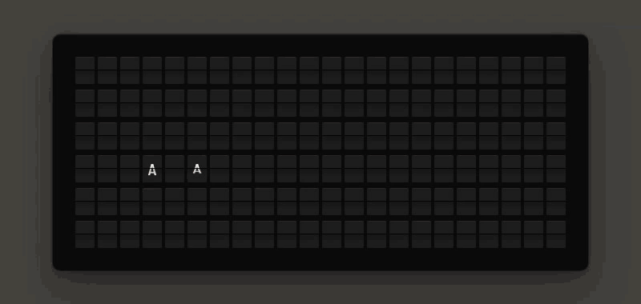
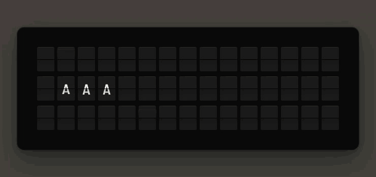
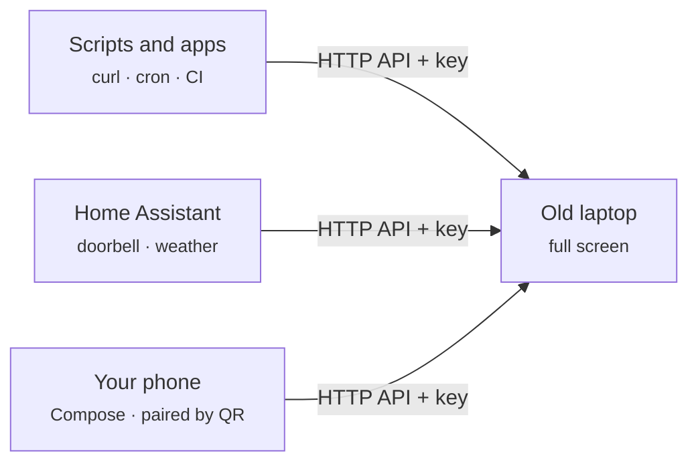
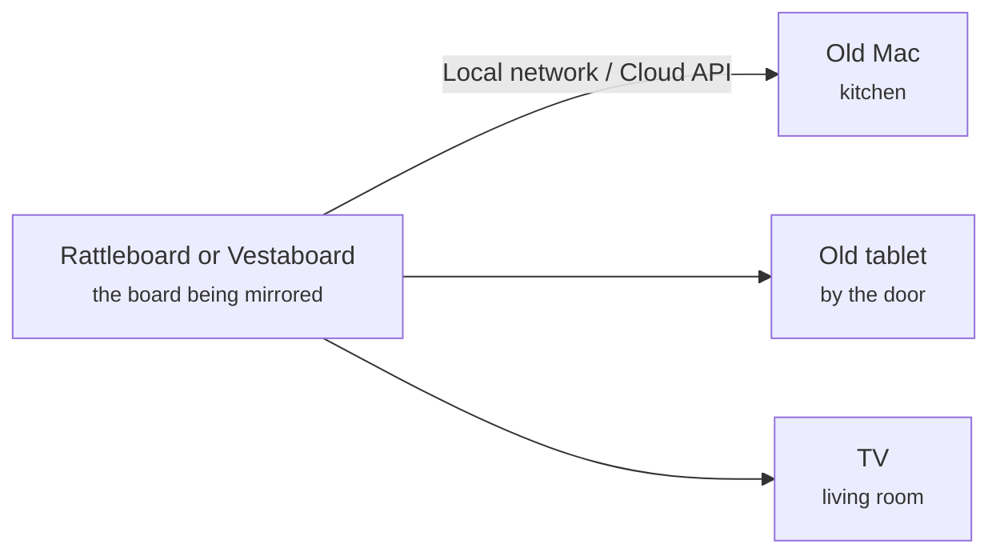
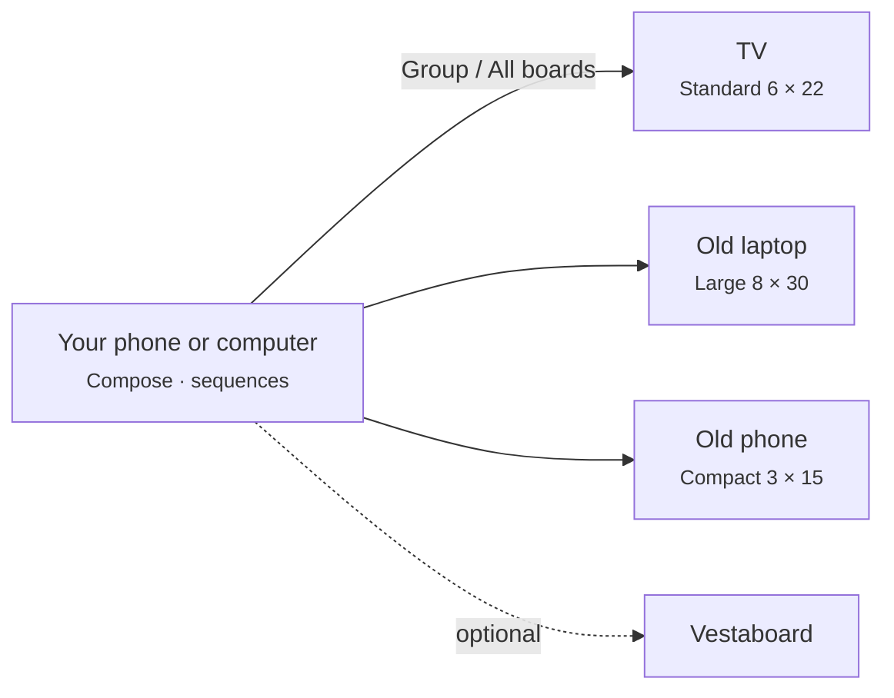
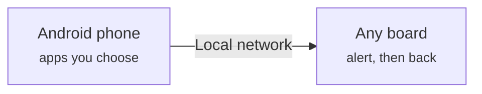
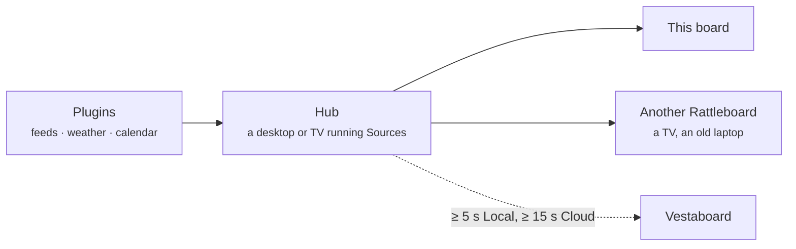

# Rattleboard

A split-flap message board for your Mac, PC or Linux desktop, or for any browser from a container on your home server. Rattleboard sits in your macOS menu bar or your Windows or Linux system tray. When a message arrives, the board flips into view (with the clatter, if you like) and then tucks away again. Pin it to the desktop, or run a spare computer full screen as a dedicated board.

Compose messages and sequences and send them to every board you own. Scripts can post to its built-in API, and it can mirror another Rattleboard, or a [Vestaboard](https://www.vestaboard.com) if you have one.

[Rattleboard Web](#rattleboard-web-docker) runs the board in a container and shows it in any browser: a wall tablet, a TV, a Home Assistant dashboard.

Free and open source under the MIT license. Rattleboard for iPhone, iPad, Android and Android TV is coming soon. Project page: [iokig.com/rattleboard](https://www.iokig.com/rattleboard).

Vestaboard is a trademark of Vestaboard, Inc. Rattleboard is not affiliated with or endorsed by Vestaboard.

<p align="center">
  <br>
  <sub>Standard (6 × 22)</sub>
</p>
<p align="center">
  <br>
  <sub>Compact (3 × 15)</sub>
</p>

## Features

- **Real split-flap motion.** The flaps spin through a full drum: blank, A–Z, 0–9, punctuation, then the colour chips, in black or white finish.
- **Any message size.** By default the board shows each message at the size it was sent at, from 1 × 1 up to 12 × 40, and the pop-up or widget resizes to fit. Or fix it at Standard (6 × 22), Compact (3 × 15), Large (8 × 30) or a custom size. See [Board sizes](#board-sizes).
- **Transitions.** Messages can flip in all at once, or in a wave: by column, reverse column, from the edges to the centre, by row, diagonally or at random. See [Transitions](#transitions).
- **Flap sound.** An optional mechanical clatter, synthesized live while the flaps turn.
- **Three ways to show it.**
  - **Pop-up:** a toast that flips into view in the corner of your choice whenever the message changes, then hides after a countdown. The countdown pauses while your pointer is over the board. Drag it toward another corner and it snaps there.
  - **Pinned widget:** stays on screen wherever you drop it, either on the desktop below your windows or above them. Rattleboard remembers its spot.
  - **Full screen:** the board fills a whole display, for a spare computer used as a board. See [Use a spare computer as a board](#use-a-spare-computer-as-a-board).
- **Any size.** Hover over the board and drag its corner handle, or use Settings → Display → Size. The size is remembered.
- **Local API or Cloud API.** Read the board directly over your Wi-Fi, or through `cloud.vestaboard.com` from anywhere.
- **Built-in API server.** Your own apps and scripts send Rattleboard messages over your network, and it also accepts the Vestaboard Local API request format. See [API server](#api-server).
- **Compose and Send.** Write a message as text or paint it tile by tile, preview it in flaps, then show it here or send it to a TV or computer running Rattleboard, or to a real Vestaboard: one board, a group of them, or all at once. See [Compose](#compose).
- **Sequences.** Play several messages in turn, each held for a while once its flaps settle, once or on a loop.
- **Pair a phone.** Show a QR code that the Rattleboard phone app scans to add this board.
- **Notification forwarding (Windows).** Put notifications from the apps you choose on a board. See [Notification forwarding](#notification-forwarding-windows).
- **Demo mode.** No board yet? It flips through sample messages so you can try everything.
- **Sources.** Left to itself, the board takes turns showing a clock, the weather, countdowns, news feeds, your calendar, a quote of the day or anything a plugin fetches, calmly, and it can drive your other boards too. See [Sources and plugins](#sources-and-plugins).
- **Message history.** Shows recent changes. **Flip again** replays any of them here, **Send to** sends that exact layout to a saved board, and **Edit** opens it in Compose.

## Install

On macOS, install with [Homebrew](https://brew.sh):

```sh
brew tap slastrina/tap
brew trust --tap slastrina/tap   # Homebrew 7+ only loads casks from taps you trust
brew install --cask rattleboard
```

Or download the latest installer from [Releases](https://github.com/slastrina/rattleboard/releases).

| Platform | File | First launch |
| --- | --- | --- |
| macOS 11+ (Apple Silicon and Intel) | `Rattleboard_x.y.z_universal.dmg` | Signed and notarized; just open it |
| Windows 10/11 | `Rattleboard_x.y.z_x64-setup.exe` or `.msi` | If SmartScreen appears, choose **More info → Run anyway** |
| Linux x86_64 (Debian 12, Ubuntu 22.04+) | `Rattleboard_x.y.z_amd64.deb` | `sudo apt install ./Rattleboard_x.y.z_amd64.deb`; see [Linux](#linux) |
| Linux x86_64 (other distributions) | `Rattleboard_x.y.z_amd64.AppImage` | `chmod +x` it, then run it; see [Linux](#linux) |
| Raspberry Pi 4/5 and other arm64 Linux (64-bit Raspberry Pi OS Bookworm, Debian 12, Ubuntu 22.04+) | `Rattleboard_x.y.z_arm64.deb` or `Rattleboard_x.y.z_aarch64.AppImage` | `sudo apt install ./Rattleboard_x.y.z_arm64.deb`; see [Raspberry Pi](#raspberry-pi) |

For a server or a NAS, [Rattleboard Web](#rattleboard-web-docker) runs as a container: `docker run -p 7070:7070 -v rattleboard:/data slastrina/rattleboard-web`.

### Updates

Rattleboard checks GitHub for a newer release once a day. When there is one, **Update available** appears at the top of the menu-bar / tray menu and in **Settings → Behavior**; clicking it opens the release page. It never downloads or installs anything itself: update with the new installer, or with `brew upgrade --cask rattleboard` if you installed with Homebrew. Turn **Check for updates automatically** off in **Settings → Behavior** to stop the checks (**Check for updates** there still checks on demand).

### Phones, tablets and TVs (coming soon)

Rattleboard for iPhone, iPad, Apple TV, Android and Android TV is on its way to the App Store and Google Play, as a one-off purchase with no subscription. Store links will be added here when they're live.

| Platform | Where | Setting it up |
| --- | --- | --- |
| iPhone and iPad (iOS 16+) | App Store *(link coming soon)* | Install it, open it, and choose a board to show or send to. To pair with a Rattleboard, scan the QR code from its **Settings → API server → Pair a phone** (on a TV, from its menu). Add the home-screen widget to see the board at a glance |
| Apple TV (tvOS 16+) | App Store, included with the iPhone and iPad purchase *(link coming soon)* | Install it from the TV's App Store. It opens as a full-screen board with its own API server and Sources; pair your phone from its menu to send to it and set up its rotation |
| Android phones and tablets (Android 8+) | Google Play *(link coming soon)* | Install it, open it, and pair by scanning a board's QR code. Optional: notification forwarding, which sends the notifications of the apps you choose to a board |
| Android TV and Google TV (Android 8+) | Google Play on the TV *(link coming soon)* | Install it from the TV's Play Store. It opens as a full-screen board with its own API server and Sources; pair a phone from its menu, and use ◀ ▶ on the remote to skip to the next card |

## Connecting your board

The first launch opens a short setup:

- **Standalone board** (recommended). Needs nothing: this computer is the board. Setup asks what it should do: **Show sources** (a rotation of clocks, countdowns, weather, news and quotes; pick a few starters, change them later in **Settings → Sources**) and **Accept messages** (turns on the [API server](#api-server), shows the address, a `curl` example and the phone pairing code). In **Settings → Connection** this is **Read from: Virtual board**.
- **Mirror another board.** Mirror another Rattleboard on your Wi-Fi: a TV, desktop or phone. Setup lists the Rattleboards it finds on your network; you need the other board's address (for example `192.168.1.20:7070`) and its API key, from its **Settings → API server**. Rattleboard calls `GET http://<address>/local-api/message`.
  - This also works with a Vestaboard's Local API: enter its IP address (port 7000 is assumed) and the **Local API key** Vestaboard issues when you enable the Local API for your board.
- **Cloud.** For a Vestaboard through the cloud. Needs a **Cloud API token**; see [Vestaboard's API docs](https://docs.vestaboard.com) for how to get one. Rattleboard calls `GET https://cloud.vestaboard.com/`.
- **Demo.** Needs nothing.

You can change the source any time in **Settings → Connection**. A mirrored board takes the size of the board it reads.

## Give an old screen a second life

That old laptop in a drawer is a split-flap display. Computers, tablets and phones that are too slow for everyday use are still good at showing a board full screen. Running Rattleboard on one keeps a working screen in use instead of sending it to e-waste.

Prop one on a shelf, mount it by the front door, or plug an old mini PC into a spare monitor. Each one can be a board of its own, a mirror of another board, or part of a group you send to all at once.

| Device | Needs | Status |
| --- | --- | --- |
| Old Mac (MacBook, iMac, Mac mini) | macOS 11 or later | **Available now:** [Releases](https://github.com/slastrina/rattleboard/releases/latest) or Homebrew |
| Windows laptop, NUC or mini PC | Windows 10 or 11 | **Available now:** [Releases](https://github.com/slastrina/rattleboard/releases/latest) |
| Raspberry Pi 4 or 5 | 64-bit Raspberry Pi OS (Bookworm) with desktop | **Available now:** [Releases](https://github.com/slastrina/rattleboard/releases/latest); see [Raspberry Pi](#raspberry-pi) |
| Android phone, tablet, TV or TV box | Android 8 or later | Coming soon; links to come |
| iPhone or iPad | iOS 16 or later | Coming soon; links to come |

To set up a spare computer as a board, see [full screen](#use-a-spare-computer-as-a-board): turn on full screen, **Open in full screen at launch** and **Start Rattleboard when I log in**, and it comes back on its own after a restart.

### How they connect

**A board of its own.** The old device is the board. Scripts, smart-home automations and your phone send it messages over your network.



**A mirror.** Every screen shows the same board. Mirror a Rattleboard on your Wi-Fi, or a Vestaboard through its Local or Cloud API.



**One message, every screen.** Compose once and send it to a group or to every board you own. Each board lays the message out to fit its own size.



**Notifications on the wall.** An Android phone forwards notifications from the apps you pick, such as a doorbell or a delivery, then the board goes back to what it was showing. On desktop, Windows can do the same.



## Use a spare computer as a board

An old Mac, a Windows laptop or a NUC behind a TV makes a good split-flap board. Full screen covers a whole display, menu bar, Dock and taskbar included, with the board centred on a solid background (near-black for the black finish, light for the white one) and scaled to fit with a comfortable margin. Every board size works; with **Match each message**, the tiles rescale whenever a message of another size arrives.

- **Turn it on** in **Settings → Display → Show as → Full screen**, with **Full screen** in the tray menu, or with F11 (and Control-Command-F on macOS). Esc leaves full screen, back to the pop-up or widget you had before.
- **Pick the display** under **Settings → Display → Display** when there's more than one. Rattleboard remembers it by name, and by position to tell two of the same model apart. If it's unplugged, the board moves to the main display, and it re-fits when the resolution changes.
- **Controls:** move the mouse or tap the screen for a small bar with the source and status, **Exit full screen**, **Replay**, **Pair a phone** and **Settings**. The bar and the pointer hide again after 3 seconds without movement.
- **Keep-awake:** while the board is full screen, the display doesn't sleep and the computer doesn't idle to sleep. It never hides, and the pop-up countdown doesn't apply. On macOS, `pmset -g assertions` lists it as "Rattleboard is showing the board full screen".
- **Running unattended:** in **Settings → Behavior**, turn on **Start at login** and **Full screen at launch**. The computer then starts straight into the board after a restart or a power cut. Without **Full screen at launch**, full screen lasts until Rattleboard quits.
- **Pairing phones:** **Pair a phone** shows the pairing QR code on the board's own screen (see [Pairing a phone](#pairing-a-phone)), so a phone can add the board without anyone touching the computer. It offers to turn on the API server and **Other devices** if they're off.
- The free desktop app shows a small "iokig.com" in the corner of the screen in full screen.

Everything else keeps working in full screen: the API server, sequences, Compose, Message History and the tray menu. Settings and Compose open above the board.

## Rattleboard Web (Docker)

Rattleboard Web is a Rattleboard that runs in a container on a home server, a NAS or a Raspberry Pi, and shows the board in any browser: a wall tablet, a TV's browser, a Home Assistant dashboard. It has the same API as every Rattleboard, so scripts, the phone apps and the desktop's **Send to** all talk to it the same way, and it runs [Sources](#sources-and-plugins) by itself on the server.

```sh
docker run -d --name rattleboard --restart unless-stopped \
  -p 7070:7070 -v rattleboard:/data slastrina/rattleboard-web
```

Open `http://<server>:7070/` in a browser for the board. The image is small (about 15 MB, a static binary on a distroless base) and built for amd64 and arm64, and from the release after 0.4.0 also for 32-bit arm (arm/v7). On a Raspberry Pi, see [Raspberry Pi](#raspberry-pi). It is on Docker Hub as `slastrina/rattleboard-web` and on GitHub as `ghcr.io/slastrina/rattleboard-web`; both are the same image.

- **The board page** fills the window with the board, fitted to whatever size and shape the screen is, on a dark background (light for the white finish). Tap or click once for full screen. The pointer hides after 3 seconds without movement, and the page keeps the screen awake with the browser's Wake Lock, which browsers only allow on `https://` addresses or `localhost` (on plain `http://` from another device, set the tablet or kiosk browser itself to stay awake). The small "iokig.com" credit stays in the corner, as in the desktop's full screen.
- **Live on every screen.** Each browser gets every change pushed to it as it happens (Server-Sent Events), so any number of screens can watch one board and flip together. A screen that loses the connection shows a small red dot and reconnects by itself.
- **Read-only.** The board page can't change anything and never holds the API key. Writes go through the [API](#api-server) with the key.
- **Command plugins are refused** (`403`), as on the phones: a container has no business running programs for a manifest. Every other plugin kind and every [built-in source](#built-in-sources) works, running on the server.

Get the API key, generated into `/data` on first start:

```sh
docker exec rattleboard rattleboard-web key
curl -X POST http://<server>:7070/local-api/message \
  -H "X-Vestaboard-Local-Api-Key: <key>" -d '{"text": "Hello from the server {66}"}'
```

### Rattleboard Web settings

Everything is set with environment variables (`-e NAME=value`):

| Variable | Default | What it does |
| --- | --- | --- |
| `RATTLEBOARD_KEY` | generated into `/data/api-key` | The API key for writes (16 characters or more) |
| `RATTLEBOARD_NAME` | `Rattleboard Web` | The board's name, as apps and `/rattleboard/info` show it |
| `RATTLEBOARD_SIZE` | `standard` | `standard` (6 × 22), `compact` (3 × 15), `large` (8 × 30) or `custom` |
| `RATTLEBOARD_ROWS`, `RATTLEBOARD_COLS` | | The custom size: 2–12 rows, 8–40 columns |
| `RATTLEBOARD_ADAPTIVE` | `false` | `true` shows each message at its own size, like **Match each message** |
| `RATTLEBOARD_FINISH` | `black` | `black` or `white` |
| `RATTLEBOARD_VIEWERS` | `open` | Who may watch the board page: `open` or `token` (see below) |
| `RATTLEBOARD_VIEWER_TOKEN` | generated into `/data/viewer-token` | The viewer token, when viewers need one (setting it turns `token` on) |
| `RATTLEBOARD_URL` | | This board's address as phones reach it, e.g. `http://192.168.1.20:7070`, for pairing from the command line |
| `RATTLEBOARD_MDNS` | `false` | `true` announces the board on the network so other Rattleboards find it; needs `--network host` |
| `RATTLEBOARD_PORT` | `7070` | The port inside the container |
| `RATTLEBOARD_UPDATE_CHECK` | `on` | `off` skips the startup check that logs a line when a newer release is out |
| `TZ` | `UTC` | The time zone for clocks, calendars, countdowns and quiet hours, e.g. `Europe/London` |

### Who can watch, and who can write

- **Viewers, open** (the default): anyone who can reach the port can watch the board. That suits a home network.
- **Viewers, token:** with `-e RATTLEBOARD_VIEWERS=token`, the board page needs a viewer link that ends in `#v=<token>`. `docker exec rattleboard rattleboard-web viewer-url` prints it. The token sits in the URL fragment, which browsers never send to the server or put in its logs; the page hands it on to the live stream. It only lets a screen watch, never write.
- **Writes** always need the API key, in any of the [usual forms](#api-server). The key never appears in a page.
- **Secrets** that sources need (a feed token, a private calendar address) are kept in `/data/secrets.json`, readable only by the container's user (mode 0600). A container has no OS keychain, so protect the volume (and its backups) as you would the key itself. The API key and viewer token files are 0600 too.

Put the board behind your reverse proxy (Caddy, nginx, Traefik) for `https://`, which also lets the Wake Lock work from other devices. The live stream sends `X-Accel-Buffering: no`, so nginx passes it straight through.

### Pairing a phone with Rattleboard Web

Open `http://<server>:7070/pair` in a browser and enter the API key: it shows the pairing QR code (the same v2 `rattleboard://pair?v=2&url=…&key=…&name=…&rows=…&cols=…` link as the desktop's), using the address the browser reached the board at, and hides it after two minutes. Or print it in the terminal:

```sh
docker exec -e RATTLEBOARD_URL=http://192.168.1.20:7070 rattleboard rattleboard-web pair
```

Inside a container the server can't see the address your network uses for it, so set `RATTLEBOARD_URL` (on the container or on the command) for links printed this way.

### The data folder

`/data` holds `api-key`, `viewer-token`, `secrets.json`, `sources.json` (the rotation), `plugins.json` (installed plugins), `seen.json` (feed items already shown) and `board.json` (the last message, shown again after a restart). The image runs as an unprivileged user (uid 65532); a bind mount (`-v /srv/rattleboard:/data`) needs to be writable by it.

### Home Assistant

Show the board on a dashboard with a **Webpage** card:

```yaml
type: iframe
url: http://192.168.1.20:7070/
aspect_ratio: 40%
```

With viewer tokens on, use the viewer link (`…/#v=<token>`). A dashboard served over `https://` can only show an `https://` page, so in that case put the board behind your reverse proxy too.

Put the API key in `secrets.yaml`:

```yaml
rattleboard_key: "<the key from rattleboard-web key>"
```

and add a `rest_command` to `configuration.yaml`, so automations can post to the board:

```yaml
rest_command:
  rattleboard_message:
    url: "http://192.168.1.20:7070/local-api/message"
    method: post
    headers:
      X-Vestaboard-Local-Api-Key: !secret rattleboard_key
    content_type: "application/json"
    payload: '{{ {"text": message, "strategy": strategy | default("classic")} | to_json }}'
```

A doorbell automation:

```yaml
automation:
  - alias: "Doorbell on the board"
    triggers:
      - trigger: state
        entity_id: binary_sensor.front_doorbell
        to: "on"
    actions:
      - action: rest_command.rattleboard_message
        data:
          message: "{66} Someone's at the front door"
          strategy: edges-to-center
```

The same `rest_command` works with a desktop Rattleboard; point it at that computer's address and key instead.

## Linux

Rattleboard runs on Linux desktops, x86_64 and arm64 (including the [Raspberry Pi](#raspberry-pi)). Download the `.deb` (Debian 12, Ubuntu 22.04 and later; `_amd64` or `_arm64`) or the `.AppImage` (most other distributions; `_amd64` or `_aarch64`, and `chmod +x` it first) from [Releases](https://github.com/slastrina/rattleboard/releases).

- **Tray icon.** Rattleboard puts its icon in the tray through libayatana-appindicator (`libayatana-appindicator3-1`; the `.deb` installs it, and with the AppImage install it from your distribution if the icon is missing). Clicking it opens the menu. KDE Plasma, Xfce, Cinnamon, MATE and Ubuntu's own GNOME show it as they are. Stock GNOME (Fedora, Debian) hides tray icons until you install the [AppIndicator and KStatusNotifierItem Support](https://extensions.gnome.org/extension/615/appindicator-support/) extension (package `gnome-shell-extension-appindicator`).
- **No tray?** Rattleboard checks at launch. Without one it opens Settings as a normal window instead, with a **Quit Rattleboard** button under Behavior; the board still pops up for messages after the window closes, and opening Rattleboard again from your app menu brings Settings back.
- **Keys** go in the Secret Service keyring: GNOME Keyring or KWallet, unlocked when you log in. Without one, saving a key fails with an error that says so. Rattleboard never falls back to writing keys to a file.
- **Pop-up placement.** On X11 the pop-up sits in the corner you choose and a pinned widget stays where you put it. Wayland doesn't let apps place their own windows, so Rattleboard runs through XWayland when it's there (as most Wayland desktops include), which keeps placement working. Without XWayland, or with `RATTLEBOARD_NATIVE_WAYLAND=1` (or a `GDK_BACKEND` of your own), it runs on Wayland directly and the compositor decides where the pop-up and widget appear, usually the middle of the screen. Full screen works either way.
- **Full screen keep-awake** asks the desktop over D-Bus to stop the screen blanking (`org.freedesktop.ScreenSaver`, or the desktop portal's inhibit), and lets go when full screen ends or Rattleboard quits.
- **Start at login** adds a `.desktop` file to `~/.config/autostart` (for the AppImage it points at the AppImage file, so keep that where it is).
- **Notification forwarding** isn't available on Linux yet.

## Raspberry Pi

A Raspberry Pi behind a TV or a small HDMI screen makes a good dedicated board. Run the desktop app full screen, or run [Rattleboard Web](#rattleboard-web-docker) in Docker and show it in Chromium in kiosk mode.

**What you need:** a Raspberry Pi 4 or 5 with 2 GB of memory or more, a display, and **Raspberry Pi OS (64-bit), Bookworm, with desktop** ("Raspberry Pi OS (64-bit)" in Raspberry Pi Imager; not Lite, which has no desktop to show the board on).

### The desktop app

1. Download `Rattleboard_x.y.z_arm64.deb` from [Releases](https://github.com/slastrina/rattleboard/releases/latest) and install it:

   ```sh
   sudo apt install ./Rattleboard_x.y.z_arm64.deb
   ```

   apt pulls in what it needs from Raspberry Pi OS (WebKitGTK, libayatana-appindicator, and GNOME Keyring for keys). The `_aarch64.AppImage` works too.
2. Open Rattleboard from the applications menu and finish the first-run setup.
3. In **Settings → Display → Show as**, choose **Full screen**. In **Settings → Behavior**, turn on **Start at login** and **Full screen at launch**. After a restart or a power cut, the Pi then comes straight back to the board.
4. Turn screen blanking off: `sudo raspi-config`, then **Display Options → Screen Blanking → No**, and reboot. Rattleboard asks the desktop to keep the screen awake while it's full screen, but don't rely on every Raspberry Pi OS desktop honouring that.

The [API server](#api-server) works as on any computer: turn it on with **Other devices** and scripts on your network post to `http://<pi>:7070/local-api/message`. If the taskbar shows no Rattleboard icon, Rattleboard opens Settings as a window instead (see [Linux](#linux)). Raspberry Pi OS uses Wayland on a Pi 4 or 5, so Rattleboard runs through XWayland; full screen works either way.

### Rattleboard Web and a Chromium kiosk

Instead of the desktop app, run the board as a container and show it in Chromium, which Raspberry Pi OS already has. This also suits a Pi with no screen of its own that serves the board to tablets and TVs elsewhere.

```sh
curl -fsSL https://get.docker.com | sh
sudo docker run -d --name rattleboard --restart unless-stopped \
  -p 7070:7070 -v rattleboard:/data slastrina/rattleboard-web
```

To open the board full screen at login, create `~/.config/autostart/rattleboard-kiosk.desktop`:

```ini
[Desktop Entry]
Type=Application
Name=Rattleboard kiosk
Exec=sh -c 'sleep 5; chromium-browser --kiosk --noerrdialogs --no-first-run http://localhost:7070'
```

On Raspberry Pi OS releases where the command is `chromium`, use that instead. The pause gives the container a moment to start after boot. Turn screen blanking off as above; on `localhost` the page also keeps the screen awake itself. Post messages with the key from `sudo docker exec rattleboard rattleboard-web key`.

### Older and smaller Pis

- **32-bit Raspberry Pi OS:** the desktop app is 64-bit only (there's no armhf build). Rattleboard Web runs on 32-bit Raspberry Pi OS (arm/v7) from the release after 0.4.0; until then, use 64-bit Raspberry Pi OS.
- **Raspberry Pi 3 and Zero 2 W** can run 64-bit Raspberry Pi OS and the arm64 builds, but they aren't tested, and with 1 GB or 512 MB of memory a WebKit or Chromium window showing the board may struggle. Rattleboard Web itself is light, so they suit serving the board to tablets and TVs elsewhere.
- **Raspberry Pi Zero, Zero W and Pi 1** (ARMv6) aren't supported.

## Board sizes

**Settings → Display → Size** chooses how big the board is:

- **Match each message** (the default): every message shows at its own size, and the pop-up or widget resizes to fit before the flaps turn. A pop-up stays in its corner; a pinned widget keeps its top-left corner. Text that doesn't ask for a size, and the demo, use the size picked below it.
- **Fixed:** Standard (6 × 22), Compact (3 × 15), Large (8 × 30), or a custom size from 2 × 8 to 12 × 40. A message of another size is centred on the board, padded with blanks or cropped from the middle.

**Tile size** (or the board's corner handle) sets how big each tile is, so a Compact message makes a smaller board at the same tile size.

### Where your keys go

Keys and tokens are stored only in your operating system's credential store: the macOS Keychain, the Windows Credential Manager, or the Secret Service keyring (GNOME Keyring, KWallet) on Linux. [Rattleboard Web](#who-can-watch-and-who-can-write) has no keychain and keeps them in 0600 files in its data volume instead. That includes the key of every saved board in **Settings → Boards**, each under its own entry. They are never written to a file, logged, or sent anywhere except the board they belong to. The same goes for each source's secrets (a feed token, a private calendar address), one entry per source and secret. Non-secret files live in the app's config folder: `settings.json` (finish, size, corner and so on), `boards.json` (saved boards' names, addresses and sizes), `groups.json`, `drafts.json` (Compose drafts), `sources.json` (the rotation and how sources run) and `plugins.json` (installed plugin manifests); `history.json`, `recent.json` (messages sent from Compose) and `seen.json` (feed items already shown) sit in the app's data folder.

## API server

Turn it on in **Settings → API server**. Rattleboard then listens on port `7070` by default. A real board uses 7000, but AirPlay receivers on Macs and many TVs already hold that port. It accepts the request formats of all three Vestaboard APIs, so most existing Vestaboard clients work once you point them at Rattleboard's address and give them its key.

- By default only apps on this computer can connect. Turn on **Other devices** to accept requests from your network, for example from the Rattleboard phone apps.
- Rattleboard creates a random key the first time the server starts. It's kept in the OS credential store, and **New key** replaces it.
- Every request needs that key, in any one of these forms:
  - `X-Vestaboard-Local-Api-Key: <key>`
  - `X-Vestaboard-Read-Write-Key: <key>`
  - `X-Vestaboard-Token: <key>`
  - `Authorization: Bearer <key>`

| Request | Body | Response |
| --- | --- | --- |
| `GET /local-api/message` | — | The current layout: `[[0,8,5,…], …]` |
| `POST /local-api/message` | A layout array, `{"characters": [[…]]}` or `{"text": "…"}` | `201 {"status":"ok","id":"…"}` |
| `GET /` | — | `{"currentMessage": {"layout": "<JSON string>", "id": "…"}}` (Read/Write and Cloud API style) |
| `POST /` | Same bodies as above | `201 {"status":"ok","id":"…"}` |

- **Layouts** use Vestaboard character codes: 0 is blank, 1–26 are A–Z, 27–36 are 1–9 and 0, 37–62 are punctuation, 63–70 are the colour chips and 71 is a filled tile. A layout can be any rectangle from 1 × 1 to 12 rows × 40 columns. With **Match each message** it shows at its own size; a fixed-size board centres it.
- **`text`** is upper-cased, word-wrapped and centred. Put `{63}` in the text to insert a raw character code. It may ask for a size with `"rows"` (2–12) and `"cols"` (8–40): `{"text": "Hi", "rows": 3, "cols": 15}`. Rattleboard follows that with **Match each message**, and otherwise uses its own size.
- **Transitions:** the object forms also take `strategy`, `step_interval_ms` and `step_size`, as a Vestaboard's Local API does. See [Transitions](#transitions).
- **Browsers:** CORS is open, so pages running in a browser can call the server too. They still need the key.

```sh
curl -X POST http://127.0.0.1:7070/local-api/message \
  -H "X-Vestaboard-Local-Api-Key: $RATTLEBOARD_KEY" \
  -d '{"text": "Build passed {66}"}'
```

```sh
# Flip it in column by column, two columns every 80 ms
curl -X POST http://127.0.0.1:7070/local-api/message \
  -H "X-Vestaboard-Local-Api-Key: $RATTLEBOARD_KEY" \
  -d '{"text": "Doors open", "strategy": "column", "step_interval_ms": 80, "step_size": 2}'
```

While Rattleboard is mirroring a real board or the demo, a message posted to the API shows up right away. The mirrored board's next change replaces it. To use Rattleboard purely as a virtual board, set **Connection → Read from** to **Virtual board**.

### Rattleboard endpoints

Rattleboards also answer a few requests of their own under `/rattleboard/`. They take the same key.

| Request | Body | Response |
| --- | --- | --- |
| `GET /rattleboard/info` | — | `{"app":"rattleboard","protocol":3,"version":"0.4.1","platform":"macos","name":"…","board":{"rows":6,"cols":22},"adaptive":true,"features":["sequence","strategy","sources"]}` |
| `POST /rattleboard/sequence` | `{"name":"…","loop":true,"frames":[…]}` (up to 256 KB) | `201 {"status":"ok","id":"seq-…","frames":2}` |
| `GET /rattleboard/sequence` | — | `{"running":true,"id":"seq-…","name":"Morning","frame":2,"frames":5,"loop":true}` or `{"running":false}` |
| `DELETE /rattleboard/sequence` | — | `204`; the current frame stays on the board |

`platform` is `macos`, `windows`, `linux` or `web` ([Rattleboard Web](#rattleboard-web-docker)). A real Vestaboard answers `404` or `401` to these, which is how apps tell the two apart. The `/rattleboard/sources` endpoints are under [Sources and plugins](#sources-api).

A sequence has 1–100 frames. Each frame is `characters` or `text` (with an optional size hint), as in a normal post, with `hold` (1–3600 seconds) and an optional transition. With **Match each message**, each frame can have its own size. A frame is held for `hold` seconds after its flaps finish, so it's never cut off mid-flip. Without `"loop": true`, the last frame stays up. Starting a sequence replaces the one playing; any normal message stops it.

```sh
curl -X POST http://127.0.0.1:7070/rattleboard/sequence \
  -H "X-Vestaboard-Local-Api-Key: $RATTLEBOARD_KEY" \
  -d '{"name": "Morning", "loop": true, "frames": [
        {"text": "Good morning", "hold": 8, "strategy": "edges-to-center"},
        {"text": "Coffee is ready {66}", "hold": 5}
      ]}'

curl http://127.0.0.1:7070/rattleboard/sequence -H "X-Vestaboard-Local-Api-Key: $RATTLEBOARD_KEY"
curl -X DELETE http://127.0.0.1:7070/rattleboard/sequence -H "X-Vestaboard-Local-Api-Key: $RATTLEBOARD_KEY"
```

The tray menu shows a playing sequence ("Playing ‘Morning’ 2/5") with a **Stop** button.

### Pairing a phone

**Settings → API server → Show pairing code** shows a QR code that the Rattleboard phone app (or the phone's camera) scans to add this board. It needs **Other devices** turned on, and offers to turn it on. The code holds this computer's name and network address, the board's size and the API key, so it's shown only when you ask and disappears after two minutes. **Copy link** copies the same `rattleboard://pair?…` link, which another Rattleboard desktop can paste under **Settings → Boards → Pair link**.

With **Other devices** on, Rattleboard also announces itself on your network (as `Rattleboard (<computer name>)`, an `_http._tcp` service) so other Rattleboards can find it.

## Sources and plugins

When nothing else is going on, Rattleboard can run a **rotation** of sources: each takes its turn on the board, then the next comes round. Set it up in **Settings → Sources**.

- **Built in:** a clock, countdowns, the weather, RSS and Atom feeds, a calendar (iCal address), any JSON API, a message of the day and a quote of the day. See [Built-in sources](#built-in-sources).
- **Plugins:** a `.rattleboard-plugin.json` file adds a source of your own: a feed, a JSON API, a text card, or (on this computer, once you allow it) a program's output. See [Plugin manifests](#plugin-manifests).
- Everything runs on this computer. There's no cloud service, and nothing is sent anywhere but the sources' own addresses.

### The rotation

- Each source in the rotation has an on/off switch, a **weight** (1–10: how often it comes round, relative to the others), how long it **shows for**, a colour chip, and an optional **schedule** (for example the clock only overnight, news 7–9 am on weekdays). Drag ⋮⋮ to reorder. You can add the same plugin more than once, say a countdown each for two birthdays.
- **In turn** shows them in order, spreading out the heavier ones; **Shuffle** picks at random, never the same twice running.
- **Next** moves on at once and restarts that card's time: in Settings, in the tray menu, on the board's hover bar, in full screen's controls, or with the → key on the board.
- **Up next** lists the coming hour, and why each card comes up: "Ambient", "after the held message", "after quiet hours", "Alert · Standup starts at 9:30".
- The **preview** shows any source's card in real flaps, as it would look right now.

### Priorities

- **Ambient:** the rotation. Its cards never pop the board up or fill Message History; a pinned or full-screen board simply changes.
- **Message:** anything else put on the board (Compose, the API, a sequence, a forwarded notification) holds the rotation for 30 minutes by default (**Hold messages for**), then it carries on.
- **Alert:** a feed item mentioning one of your alert words, an event starting in 10 minutes, a countdown's day, or a command plugin asking for it. It interrupts for 15 seconds (**Alerts stay up**), then the board goes back to whatever it showed before, a held message included.

### Calm by default

- Feed items show **once**. Rattleboard remembers what it has shown (`seen.json`), so nothing flips up twice, even after a restart. A newly added feed shows its newest item and remembers the rest.
- A **burst** of more than three new items becomes one digest card: "5 NEW - HACKER NEWS" with the newest headline.
- At most 30 **card changes an hour** (adjustable); a clock ticking over to the next minute doesn't count, and neither does pressing Next.
- **Quiet hours** stop anything new going up overnight. Feed alerts that come in then are let go; a celebration or the day's quote waits until morning.
- Each feed source can keep only items **with** some words, **skip** items with others, and **alert** on others.
- While this board **mirrors** another board (or the demo), sources are paused, unless **Show sources while mirroring** is on. A **Virtual board** with a source turned on runs its rotation by itself, forever.

### Built-in sources

| Source | What it shows |
| --- | --- |
| **Clock** | Big digits made of tiles (time and date below), time and date, or a world clock of up to 3 cities (looked up by name, or given as a time zone like `Europe/London`). Re-drawn as the minute changes. |
| **Countdown** | "12 DAYS TO SAM'S BIRTHDAY"; on the last day hours, and in the last hour a minute ticker if you like. One-off or every year, or a preset: New Year's Eve, Christmas, Halloween. On the day: a celebration card ("HAPPY BIRTHDAY SAM", between bands of colour), once, as an alert. |
| **Weather** | Now, today's high and low, rain and wind for a city, from [Open-Meteo](https://open-meteo.com) (no key needed). °C or °F. |
| **RSS or Atom feed** | New stories from any feed address. |
| **Calendar (iCal)** | Your next event (recurring events included), and an alert 10 minutes before it starts. Use the "secret address in iCal format" from Google Calendar, iCloud or Outlook; it's kept in the credential store like a password. |
| **JSON URL** | Any JSON API, no code: the address, an optional path to a list of items, paths to the title and body, and an optional card template. |
| **Message of the day** | Your own list of messages, a different one each day. |
| **Quote of the day** | One of 600+ public-domain quotes (authors who died before 1955), the same on every board each day, picked from those that fit the board with their "- AUTHOR" line. Choose any, work, calm, funny or wisdom; in the rotation, or once a day at a set time as a message; and add your own ("text - author", one per line), mixed in or on their own. The list is `data/quotes.json`. |

### Showing sources on other boards

**Show sources on** picks where the cards go: this board (the default) and any saved boards or groups, including real Vestaboards on the Local or Cloud API. A desktop running Rattleboard then works as a **hub**.

- Every board gets each card laid out for its own size: a Compact board gets the Compact layout, and a quote that fits it.
- A real Vestaboard gets a card at most every 5 s on its Local API and 15 s on the Cloud, as Vestaboard's limits require; a card that a newer one replaces while it waits is dropped. Other Rattleboards take cards as fast as they come.
- The hourly cap applies to each board.
- A board that's offline is retried later (30 s, then 1, 2, 4 minutes and so on, up to 10) and never holds up the rotation or the other boards.



### Plugin manifests

A plugin is one JSON file, `*.rattleboard-plugin.json`:

```json
{
  "format": 1,
  "id": "com.example.hn",
  "name": "Hacker News",
  "description": "Top stories",
  "kind": "rss",
  "fetch": { "url": "https://hnrss.org/frontpage", "every": "15m" },
  "card": { "chip": "orange", "pages": 2 },
  "alertWhen": ["keyword:launch", "keyword:outage"],
  "maxItems": 5,
  "dwell": "30s",
  "schedule": { "days": ["mon", "tue", "wed", "thu", "fri"], "from": "07:00", "to": "10:00" },
  "settings": [{ "key": "city", "label": "City", "type": "text", "default": "Melbourne" }],
  "secrets": [{ "key": "token", "label": "API token" }]
}
```

| Field | |
| --- | --- |
| `format` | `1` |
| `id` | 3–100 letters, digits, dots, dashes or underscores, like `com.example.news`. Installing a manifest with the same id updates it. `rattleboard.` is kept for the built-ins. |
| `name`, `description` | Shown in Settings → Sources |
| `kind` | `rss` (RSS and Atom), `json`, `ical`, `text`, or `command` (this computer only) |
| `fetch` | `url`, optional `method` (`GET` or `POST`) and `headers`, and `every` (at least `1m`, default `15m`). For `rss`, `json` and `ical`. The address must be `https://`, or `http://` to a host on your own network (a private IP address, `localhost`, `*.local`, `*.lan`, `*.home.arpa` or a single-word name). Each fetch has 10 s, and the answer may be up to 2 MB. |
| `pick` | For `json`: JSONPath for `items` (optional: without it the whole document is one card), and for each item's `id`, `title`, `body` and `time`. The supported subset is `$`, `.key`, `['key']`, `[n]` and `[*]`. RSS, Atom and iCal need no `pick`. |
| `card` | `template` (laid out over the whole board with the standard text layout; colour codes like `{r}` or `{63}` work), `chip` (a colour: red, orange, yellow, green, blue, violet, white or black), `align` (`center` or `left`) and `pages` (1–3: long text continues on more cards rather than being cut; words are never split). Without a template, the card has the source's name and the time across the top and the item below. |
| `priority` | `ambient` (default) or `alert`: every new item interrupts |
| `alertWhen` | `["keyword:launch"]`: new items mentioning one of these interrupt |
| `maxItems` | 1–50 items per fetch (default 10) |
| `dwell` | How long its card shows, `10s` to `1h`; each source in the rotation can override it |
| `schedule` | Days (`mon`…`sun`; none means every day) and `from`/`to` (HH:MM, may run past midnight) |
| `settings` | Fields shown in Settings → Sources: `key`, `label`, `type` (`text`, `number`, `toggle`, `select` with `options`, `date`, `time` or `lines`) and `default` |
| `secrets` | Fields kept in the credential store: `key` and `label` |
| `run` | For `command`: `path` (the program's full path), `args`, `every` (at least `10s`, default `5m`) and `timeout` (1–60 s, default 10 s) |

Unknown fields are ignored, so a newer manifest still loads; anything invalid is refused with a message saying what's wrong.

**Placeholders** can go in `fetch.url`, `fetch.headers` and `card.template`:

| Placeholder | |
| --- | --- |
| `{{settings.city}}` | A setting's value (URL-encoded inside a URL) |
| `{{secret.token}}` | A secret, from the credential store. Only in `fetch.url` and `fetch.headers`: never in a template, never logged, and never sent back over the API. |
| `{{name}}`, `{{title}}`, `{{body}}` | The source's name, and the item's title and body |
| `{{time}}`, `{{time:HH:mm}}` | The item's time (for an event, its start) |
| `{{now}}`, `{{now:ddd d MMM}}` | The time now. Formats use `yyyy yy MMMM MMM MM M dddd ddd dd d HH H hh h mm ss tt`; `[text]` is literal. |

**Kinds:**

- **`rss`, `json`, `ical`** fetch `fetch.url`. Feed items (RSS, or JSON with an items path) show once each; a JSON value without items, and a calendar's next event, show as they are now.
- **`text`** fetches nothing: its card is its template, re-drawn every `every` (at least `10s`), for example `"{{now:dddd}}\nTAKE THE BINS OUT"`.
- **`command`** runs a program on this computer and puts what it prints on the board: plain text, or JSON `{"text": "…", "priority": "alert", "id": "…"}` or `{"characters": [[…]]}`. There's no shell; it gets no input, and only the first 64 KB of its output is read. It's stopped at its timeout. **It never runs until you allow it here**: Settings shows the full path and arguments first, and changing the file in any way needs allowing again. Importing a command plugin never turns it on, and the API and plugin links refuse command plugins.

### Sharing plugins

- **Import:** drop a `.rattleboard-plugin.json` file on Settings → Sources, or choose it with **Import…**. In **Add source…**, a `rattleboard://plugin?url=https://…` link shows what the plugin is and asks before installing it (command plugins are refused from links).
- **Export:** a plugin's manifest, or one source with its settings (never its secrets), saved to your Downloads folder.
- Examples in [`plugins/examples`](plugins/examples): [Hacker News](plugins/examples/hacker-news.rattleboard-plugin.json) (RSS), [ISS position](plugins/examples/iss-position.rattleboard-plugin.json) (a keyless JSON API) and [git status](plugins/examples/git-status.rattleboard-plugin.json) (a command; change the folder in `args` to your repository's).

### Sources API

Rattleboards with sources (protocol 3, `"sources"` in `features`) can be set up remotely, from the phone apps for example. Every request needs the API key, and CORS is open as for the other endpoints.

| Request | Body | Response |
| --- | --- | --- |
| `GET /rattleboard/sources` | — | `{"plugins": [...], "rotation": [...], "quietHours": {...}, "holdMinutes": 30, "flipsPerHour": 30, "alertSeconds": 60, "shuffle": false, "showWhileMirroring": false, "clock24": false, "targets": ["this"], "status": {...}}`. Each source's secrets appear only as `{"token": {"set": true}}`. |
| `PUT /rattleboard/sources/rotation` | `{"rotation": [...]}` and/or any of the settings above | `200` and the same as `GET`; `400` with what's wrong. Command sources can't be added or turned on here (`403`). |
| `POST /rattleboard/sources/plugins` | A manifest | `201 {"status":"ok","id":"…"}`; `400` if invalid; `403` for a command plugin |
| `DELETE /rattleboard/sources/plugins/{id}` | — | `204`, along with its sources and their secrets; `400` for a built-in |
| `PUT /rattleboard/sources/instances/{id}/secrets` | `{"token": "…"}` (`""` clears one) | `204`. The value goes to the credential store and is never sent back. |
| `GET /rattleboard/sources/preview/{id}` | — | `{"characters": [[…]], "pages": [...], "reason": "…"}`: what it would show now, at this board's size. `?refresh=1` fetches its feed or API again first (not more than once every 5 s) |
| `GET /rattleboard/sources/upnext` | — | `[{"at": 1792323882607, "instanceId": "…", "title": "Weather", "reason": "Ambient"}, …]` |
| `POST /rattleboard/sources/next` | — | `{"status":"ok"}`: moves the rotation on now |

A source in the rotation looks like this (`plugin` is a plugin's id; the rest is optional):

```json
{"id": "weather", "plugin": "rattleboard.weather", "name": "Weather", "enabled": true, "weight": 1, "dwell": "5m",
 "schedule": {"days": ["sat", "sun"], "from": "07:00", "to": "12:00"}, "settings": {"city": "Melbourne", "units": "celsius"},
 "chip": "yellow", "include": [], "exclude": [], "alertWords": []}
```

```sh
# A clock, the weather and a countdown, with quiet hours
curl -X PUT http://127.0.0.1:7070/rattleboard/sources/rotation \
  -H "X-Vestaboard-Local-Api-Key: $RATTLEBOARD_KEY" \
  -d '{"rotation": [
        {"plugin": "rattleboard.clock", "dwell": "2m"},
        {"plugin": "rattleboard.weather", "settings": {"city": "Melbourne"}},
        {"plugin": "rattleboard.countdown", "settings": {"title": "Sam'"'"'s birthday", "date": "1990-10-30", "yearly": true}}
      ], "quietHours": {"enabled": true, "from": "22:00", "to": "07:00"}}'

curl http://127.0.0.1:7070/rattleboard/sources/upnext -H "X-Vestaboard-Local-Api-Key: $RATTLEBOARD_KEY"
curl -X POST http://127.0.0.1:7070/rattleboard/sources/next -H "X-Vestaboard-Local-Api-Key: $RATTLEBOARD_KEY"
```

## Transitions

| `strategy` | Flaps start |
| --- | --- |
| `classic` (default) | all together |
| `column` | left to right, a column per step |
| `reverse-column` | right to left |
| `edges-to-center` | from the outer columns in to the middle |
| `row` | top to bottom |
| `diagonal` | from the top-left corner, along diagonals |
| `random` | in a random order of tiles |

`step_size` (1–40, default 1) is how many columns, rows, diagonals or tiles start together, and `step_interval_ms` (1–5000, default 120) is the time between steps. An unknown strategy, or a value out of range, is a `400`.

## Compose

Open **Compose…** from the tray menu or **Settings → Boards**.

- **Text** lays out what you type exactly as a board lays out posted text, and previews it in flaps as you type. `{r}` `{o}` `{y}` `{g}` `{b}` `{v}` `{w}` `{k}` (or `{63}`–`{70}`) add colour chips.
- **Grid** lets you paint tiles: pick a letter, symbol or colour chip and click or drag across the board, or click a tile and type.
- **Transition** picks how the message flips in, and **Replay** shows it again.
- **Sequence:** **Add frame** turns the message into a list of frames. Each frame has its own hold and transition, and frames can be reordered, duplicated and deleted. **Preview** plays the sequence in Compose without sending anything.
- **Drafts** are saved in `drafts.json`, never with keys.
- **Recent** lists the last 50 messages sent from Compose. Each can be sent again, to the last board used or another, or edited. The tray menu also offers **Send this to <board>** for the board you sent to last.
- A layout is always sent exactly as drawn. If it was made for a board of another size, Compose says so; the receiving board centres it.

**Send to** picks **This board**, **All boards**, a group or one saved board, and the editor takes the board's size. For boards that match each message (this one, by default, and other Rattleboard desktops), **Message size** picks the size to send at; Compose remembers it.

- **This board** shows the message here, like a message sent to the API server.
- **Another Rattleboard** gets the message on its API, and a sequence is handed to it to play by itself.
- **A real Vestaboard** gets each message through its Local API or the Cloud API, at least 5 s apart on the Local API and 15 s apart on the Cloud, as Vestaboard's limits require; a message sent sooner waits its turn. For a sequence, this computer sends frame after frame.
- **A group, or all boards:** every board gets the message at once, each laid out for its own size: text is laid out per board, and a grid is centred on fixed-size boards of another size. Compose lists how each board took it (sent, queued, rate-limited or failed, with **Retry**), and one board failing never holds up the others. A sequence plays on all of them, with one status line and **Stop all**.

### Saved boards

**Settings → Boards** lists the boards you can send to. Add one in any of these ways:

- **Nearby:** Rattleboards that announce themselves on your network (TVs, other computers). Pick one and enter its key.
- **By address:** a Rattleboard's address and API key, or a Vestaboard's IP address and Local API key. Rattleboard asks `GET /rattleboard/info` to tell which it is.
- **Pair link:** paste a `rattleboard://pair?…` link from another Rattleboard. Rattleboard shows which board it is and asks before adding it.
- **Cloud:** a Vestaboard's Cloud API token.

Each board can be renamed or removed. Removing it deletes its key from the credential store.

**Groups** are named sets of boards, such as "Downstairs", to send to at once. A board can be in any number of groups. They're kept in `groups.json` (just names and board ids).

## Notification forwarding (Windows)

On Windows, **Settings → Notifications** puts notifications from the apps you choose on this board or a saved one.

- **Allow access…** asks Windows for permission to read notifications. You can change this later in Windows Settings → Privacy & security → Notifications.
- Apps show up in the list once they've sent a notification; tick the ones to forward. **Show on** can be this board, a saved board, a group or all boards.
- **Hide content** shows only which app it's from. **Quiet hours** pauses forwarding, for example overnight.
- **Go back after** puts the previous message back after a while, but only if the board still shows the notification.

macOS has no supported way for apps to read other apps' notifications, so this setting doesn't appear there.

## Building from source

Prerequisites: [Rust](https://rustup.rs) (stable), [Node.js](https://nodejs.org) 18+, and the [Tauri prerequisites](https://tauri.app/start/prerequisites/) for your platform (on Windows, WebView2 and the MSVC build tools; on Debian or Ubuntu, `sudo apt install libwebkit2gtk-4.1-dev libayatana-appindicator3-dev librsvg2-dev libdbus-1-dev libxdo-dev`).

```sh
npm install
npm run dev      # run with hot reload
npm run build    # produce installers in target/release/bundle
cargo test --workspace
```

The Rust code is a Cargo workspace: the desktop app in `src-tauri`, the board engine it shares with Rattleboard Web in `crates/rattleboard-core`, and the Rattleboard Web server in `crates/rattleboard-web`. To build and run Rattleboard Web locally:

```sh
docker build -f crates/rattleboard-web/Dockerfile -t rattleboard-web .
docker run --rm -p 7070:7070 -v rattleboard:/data rattleboard-web
# or without Docker
RATTLEBOARD_DATA=./web-data cargo run -p rattleboard-web
```

To try changes without touching your own settings and keys, run a debug build with `RATTLEBOARD_PROFILE=<name>`: it uses config and data folders of its own (`…rattleboard.<name>`) and keeps its keys in a `secrets.json` there instead of the credential store. Profiles can run side by side (give each its own API port), and `RATTLEBOARD_OPEN=settings/sources` opens a window at launch. Release builds ignore both.

The UI is plain HTML, CSS and JavaScript in `src/`, with no bundler. The desktop's Rust side, in `src-tauri/src/`, handles polling, the tray icon and window placement; the engine in `crates/rattleboard-core/src/` does everything that doesn't touch a window.

| Path | What it is |
| --- | --- |
| `src/shared/split-flap.js` | The `<split-flap-board>` web component: flap animation and sound |
| `src/board.*` | The floating board window |
| `src/tray.*` | The menu-bar / tray popover |
| `src/panel.*` | Settings, Message History and first-run setup |
| `src/compose.js` | Compose: the editor, sequences and drafts |
| `src/sources.js` | Settings → Sources |
| `crates/rattleboard-core/src/vestaboard.rs` | Local and Cloud API clients, text layout, transitions, plus demo messages |
| `crates/rattleboard-core/src/server.rs` | The built-in Vestaboard-compatible API server and the `/rattleboard/` endpoints |
| `crates/rattleboard-core/src/sequence.rs` | Sequence validation |
| `crates/rattleboard-core/src/boards.rs` | Saved boards, pair links, network discovery |
| `crates/rattleboard-core/src/send.rs` | Groups, and sending to several boards at once |
| `crates/rattleboard-core/src/sources.rs` | The sources engine: rotation, priorities, calm rules, Up next |
| `crates/rattleboard-core/src/plugins.rs` | Plugin manifests, placeholders, fetching, feed and calendar parsing, commands |
| `crates/rattleboard-core/src/builtins.rs` | Clock, countdowns, weather, message and quote of the day |
| `crates/rattleboard-core/src/cards.rs` | Laying cards out for any board size |
| `data/quotes.json` | The public-domain quotes, shared with the phone and TV apps |
| `plugins/examples/` | Example plugins |
| `src-tauri/src/notify.rs` | Notification forwarding (Windows) |
| `src-tauri/src/fullscreen.rs` | Full screen: picking the display, keep-awake, hiding the pointer |
| `crates/rattleboard-core/src/secrets.rs` | OS credential store (or a 0600 file, for Rattleboard Web) |
| `crates/rattleboard-core/src/settings.rs` | The desktop's settings, board size presets |
| `crates/rattleboard-web/` | Rattleboard Web: the headless server, its board page (`web/`) and Dockerfile |

### Releasing

Pushing a version tag builds the macOS (universal), Windows and Linux x86_64 and arm64 (`.deb`, AppImage) installers in GitHub Actions and attaches them to a GitHub Release, and publishes the Rattleboard Web image to Docker Hub (`slastrina/rattleboard-web`, when the `DOCKERHUB_TOKEN` secret and `DOCKERHUB_USERNAME` variable are set) and to `ghcr.io/slastrina/rattleboard-web`, for amd64, arm64 and arm/v7. The macOS build is signed and notarized when the Developer ID secrets listed in `.github/workflows/release.yml` are set on the repository.

```sh
git tag v0.4.1 && git push origin v0.4.1
```

## Support Rattleboard

Rattleboard is free and open source. If it's earned a spot on your desk or your wall, you can [buy me a coffee on Ko-fi](https://ko-fi.com/slastrina). Settings and the tray menu link there too, next to [iokig.com/rattleboard](https://www.iokig.com/rattleboard).

## Credits

- Flap typeface: [Barlow Semi Condensed](https://github.com/jpt/barlow) by Jeremy Tribby, SIL Open Font License 1.1 (`src/fonts/OFL.txt`)
- Built with [Tauri](https://tauri.app)

## License

[MIT](LICENSE)
